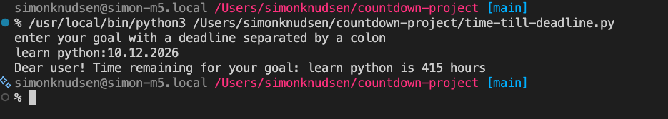

# Write Countdown Application

## Technologies used:

Python, IntelliJ, Git

## Project Description:

- Write an application that accepts a user input of a goal and a deadline (date). Print the remaining time until that deadline

_Result: the user enters the goal "learn python" with the deadline 10.12.2026, and the program prints the hours remaining until that deadline._
